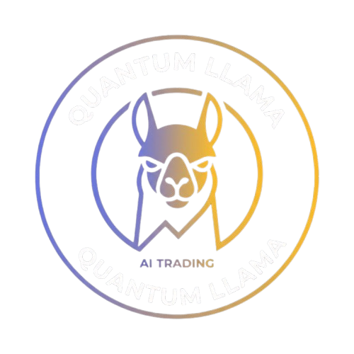
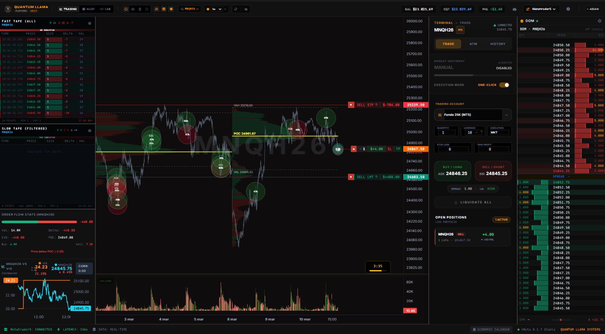
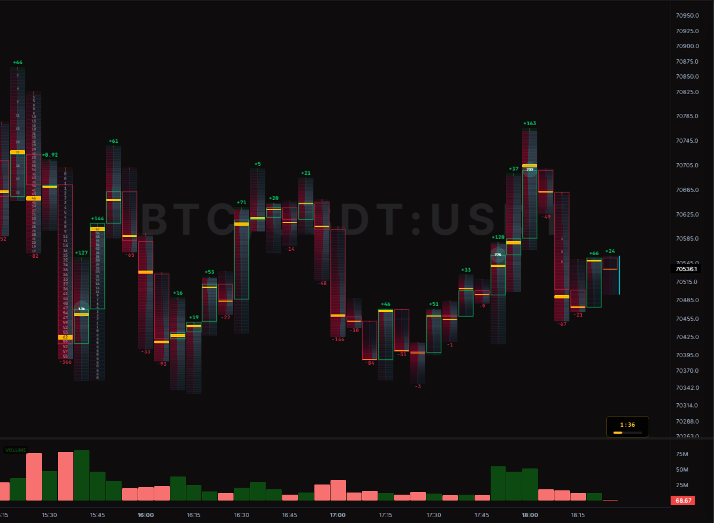
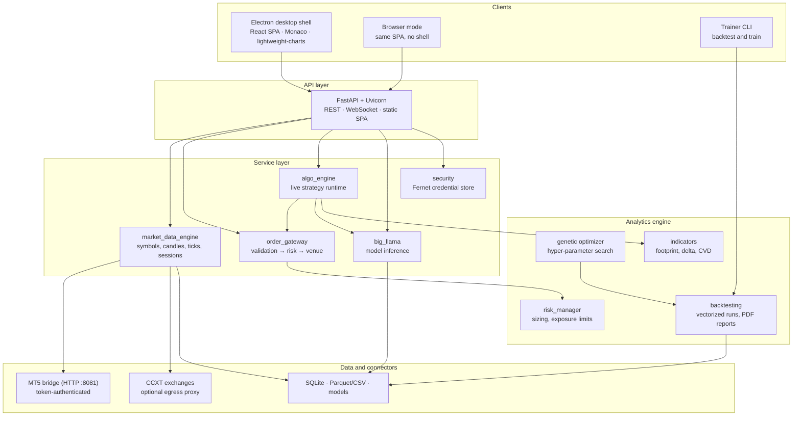

<h1 align="center">
  
  <br />
  Quantum Llama Terminal
</h1>

<p align="center">
  <strong>A multi-broker trading terminal: order-flow microstructure, machine-learning signals<br />
  and risk-gated execution — on the desktop, in the browser and from the terminal.</strong>
</p>

<p align="center">
  <a href="docs/RELEASES/v1.9.0.md"></a>
  <a href="https://github.com/QuantLlama/llama-terminal/actions/workflows/ci.yml"></a>
  
  
  
  
  
  
</p>

---

## Table of contents

- [What this is](#what-this-is)
- [Screenshots](#screenshots)
- [Architecture](#architecture)
- [Feature highlights](#feature-highlights)
- [Technology stack](#technology-stack)
- [Repository layout](#repository-layout)
- [Quickstart](#quickstart)
- [Running modes](#running-modes)
- [Testing](#testing)
- [Deployment](#deployment)
- [Documentation](#documentation)
- [Roadmap](#roadmap)
- [Contributing](#contributing)
- [Security](#security)
- [License](#license)
- [Author](#author)

---

## What this is

Quantum Llama Terminal is a trading platform built around one constraint that most
retail tools ignore: **a signal is worthless if the execution path is naive**. The
system therefore treats market data, signal generation and order placement as three
separate, independently testable layers, and connects them through a service boundary
that can be swapped per venue.

Concretely, the repository contains:

- a **desktop application** (Electron shell + React/Monaco SPA) for discretionary
  trading with footprint charts, a depth-of-market heatmap and drawing tools;
- a **FastAPI backend** that exposes the whole platform over HTTP and WebSocket, so the
  same product runs headless in a browser or from a container;
- a **broker abstraction** with a MetaTrader 5 bridge, CCXT crypto exchanges,
  NinjaTrader/Tradovate adapters and yfinance for research data;
- a **machine-learning pipeline** (feature engineering with Fourier and autoencoder
  representations, LSTM sequence models, random-forest feature selection, ARIMA and
  Gaussian-process diagnostics, genetic parameter search) that feeds the live algorithm
  engine;
- a **backtesting and optimization engine** with vectorized execution and PDF reports;
- a **risk and order gateway** that every order must pass, whether it originates from a
  manual click, an algorithm or a backtest replay.

The design goal is auditable behavior: the same order path is exercised in tests as in
production, and every credential is encrypted at rest.

---

## Screenshots

| Trading terminal | Footprint chart |
| --- | --- |
|  |  |

| Depth of market / order book heatmap |
| --- |
|  |

---

## Architecture



Three properties make the shape deliberate:

1. **One API, several clients.** The desktop shell loads the same SPA the browser mode
   serves, so a charting bug reproduces in one place. See
   [`docs/ARCHITECTURE.md`](docs/ARCHITECTURE.md).
2. **Execution is a funnel.** Strategies and UI actions never talk to a broker directly;
   they emit an order request that the gateway validates and the risk manager sizes.
3. **Data is pluggable per venue.** MetaTrader 5 is Windows-only, so the terminal speaks
   to a token-authenticated HTTP bridge instead of linking the package — the same code
   runs on Linux and in a container. See [`deploy/MT5_BRIDGE.md`](deploy/MT5_BRIDGE.md).

---

## Feature highlights

### Order flow and market microstructure

- **Footprint charts** — bid/ask volume per price level, imbalance and delta per bar.
- **Depth-of-market heatmap** — resting liquidity over time, rendered incrementally.
- **Large-trade overlays and CVD** — block-print detection, cumulative volume delta.
- **Session awareness** — instrument sessions and time zones, with weekend-gap repair.

### Machine learning

- **Feature engineering** on OHLCV, technical indicators, Fourier cycles and an
  autoencoder representation of the price series.
- **Sequence models** — an LSTM network (`src/models/generator.py`) trained per symbol and
  timeframe, with a `Tanh` output head for normalized returns.
- **Feature selection and validation** — random-forest importance, then ARIMA and
  Gaussian-process baselines for diagnosis rather than prediction.
- **Genetic search** — a DEAP-powered optimizer over backtest fitness, plus an
  evolutionary population loop in the live `big_llama` service.
- **Optional heavy dependencies** — inference must degrade gracefully when `torch` is
  absent, which is a tested property, not an aspiration.

### Execution and risk

- **Single order funnel** with validation, risk sizing and venue dispatch.
- **Multi-venue**: MetaTrader 5 (forex, indices, commodities), CCXT crypto, futures
  adapters, yfinance for research.
- **Live algorithm runtime** with start/stop/status, structured logs and telemetry.
- **Encrypted credentials** — broker logins are stored with Fernet; the key lives
  outside the repository.

### Research and reporting

- **Backtesting engine** with vectorized runs, per-trade analytics and equity curves.
- **Optimization jobs** with progress, cancellation and status polling.
- **PDF reports** for a run or an optimization batch.

### Operations

- **Cloud mode** — the same platform runs as a web application on a server while the MT5
  terminal stays on your machine. One container, three volumes, HTTPS in front —
  see [`docs/CLOUD.md`](docs/CLOUD.md).
- **Container image** (non-root user, health check, volumes) for the web/API surface.
- **Coolify deployment** documented end to end, including the MT5 relay and the crypto
  egress proxy — see [`deploy/COOLIFY.md`](deploy/COOLIFY.md).
- **Health, telemetry and status endpoints** for a supervisor to consume.

---

## Technology stack

| Layer | Technologies |
| --- | --- |
| Desktop shell | Electron 33, electron-builder (NSIS, AppImage, deb), bytenode |
| Frontend | React 19, Monaco Editor, lightweight-charts, Babel, vanilla ES modules |
| API | FastAPI 0.110, Uvicorn, WebSocket, Pydantic |
| Analytics | NumPy, Pandas, VectorBT, TA-Lib, Statsmodels (ARIMA), DEAP (genetic search) |
| Machine learning | PyTorch (LSTM, autoencoder), scikit-learn (RandomForest, Gaussian processes, scaling) |
| Brokers and data | MetaTrader 5 (via HTTP bridge), CCXT, yfinance, NinjaTrader, Tradovate |
| Persistence | SQLite, JSON configuration, Fernet-encrypted credential store |
| Build and protection | PyInstaller, PyArmor, Cython, Babel, bytenode |
| Delivery | Docker, Coolify, systemd units, GitHub Actions |
| Testing | pytest (backend and services) |

---

## Repository layout

```text
.
├── electron/            Electron main process, preload, splash and trial screens
├── src/
│   ├── algorithms/      Trading strategies (order flow, SMC, ETF, live)
│   ├── analysis/        Market regime filters and analytical helpers
│   ├── config/          Runtime configuration and symbol catalogues
│   ├── data/            Data loaders for research and backtests
│   ├── engine/          Backtesting, optimization, risk and indicator engine
│   ├── features/        Feature engineering for the models
│   ├── indicators/      Footprint, delta, CVD and volume-profile primitives
│   ├── live/            Live bridge session, position normalization, MT5 client
│   ├── models/          Model definitions and inference wrappers
│   ├── optimization/    Search strategies for parameters and models
│   ├── platform/        FastAPI application and the web SPA
│   ├── services/        Market data, order gateway, algo engine, security
│   └── utils/           Paths, logging, cleaning and shared helpers
├── tests/               Pytest suite (services, bridge, security, API)
├── docs/                Architecture, development, testing, ML, roadmap, ADRs
├── deploy/              Coolify, MT5 relay and crypto proxy runbooks
├── scripts/             Build, obfuscation, packaging and documentation checks
├── nsis/                Windows installer customization
├── mt5_server.py        Token-authenticated MetaTrader 5 HTTP bridge
├── run.py               Launcher: Terminal app, Browser mode, Trainer CLI
└── train.py             Model training entry point
```

---

## Quickstart

### From a release

| Platform | Artifact | Install |
| --- | --- | --- |
| Windows | `Quantum-Llama-Terminal-Setup.exe` | Run the installer |
| Ubuntu / Debian | `.deb` | `sudo dpkg -i Quantum-llama-Terminal_1.8.1_amd64.deb && sudo apt-get install -f` |
| Arch / EndeavourOS / Manjaro | `.pacman` | `sudo pacman -U Quantum-llama-Terminal-1.8.1.pacman` |
| Any modern Linux | `.AppImage` | `chmod +x "Quantum Llama Terminal-1.8.1.AppImage" && ./"Quantum Llama Terminal-1.8.1.AppImage"` |

### From source

Requirements: Python 3.11+, Node.js 18+, and for Windows builds the Visual Studio
Build Tools (TA-Lib needs a compiler).

```bash
git clone https://github.com/QuantLlama/llama-terminal.git
cd llama-terminal

./setup_env.sh          # Linux/macOS — use setup_env.bat on Windows
npm install             # Electron shell and frontend tooling

source venv_linux/bin/activate
python run.py           # choose: Terminal app · Browser mode · Trainer CLI
```

The backend listens on `http://127.0.0.1:8050` and health is served at `/health`.
Packaging for production:

```bash
npm run dist            # PyArmor + Cython backend, bytenode JS, electron-builder
```

Full setup, troubleshooting and the MT5 bridge are in
[`docs/DEVELOPMENT.md`](docs/DEVELOPMENT.md).

---

## Running modes

| Mode | Entry point | What it is for |
| --- | --- | --- |
| **Terminal app** | `run.py` → Terminal app | Full desktop experience: order flow, ML overlays, manual and algo trading |
| **Browser mode** | `run.py` → Browser mode | Same SPA without the Electron shell, for remote or low-resource machines |
| **Trainer CLI** | `run.py` → Trainer CLI, `train.py` | Headless training, backtesting and optimization |

---

## Testing

```bash
python -m pytest -q                     # full suite
python -m pytest tests/test_mt5_bridge_auth.py -q   # one module
```

Current state: **85 tests**, covering the MT5 bridge (authentication, session reuse,
symbol catalogue, API connector configuration), position normalization, credential
storage, the crypto egress proxy, optional-torch degradation, the SPA favicon route, the secret guard and the anon-only browser runtime configuration.

CI runs the suite on Python 3.11 and 3.12 with a deliberately minimal dependency set
(`requirements.ci.txt`), byte-compiles the sources, rejects merge-conflict markers and
validates every relative documentation link. Strategy and coverage guidance:
[`docs/TESTING.md`](docs/TESTING.md).

---

## Deployment

The desktop and the cloud are separate deliverables. The cloud shape is documented in
[`docs/CLOUD.md`](docs/CLOUD.md): topology, request paths, security model, operations and the
integration problems that had to be solved to reach MetaTrader 5 from a container.

The container image ships the web/API surface only:

```bash
docker build -t llama-terminal .
docker run --rm -p 8050:8050 --env-file .env llama-terminal
```

| Topic | Runbook |
| --- | --- |
| Coolify VPS topology, volumes, environment | [`deploy/COOLIFY.md`](deploy/COOLIFY.md) |
| MetaTrader 5 bridge under Wine/Tailscale | [`deploy/MT5_BRIDGE.md`](deploy/MT5_BRIDGE.md) |
| Crypto egress proxy (regional HTTP 451) | [`deploy/COOLIFY.md`](deploy/COOLIFY.md) |
| Systemd units for the local services | [`deploy/local/`](deploy/local) |

---

## Documentation

| Document | Contents |
| --- | --- |
| [`docs/ARCHITECTURE.md`](docs/ARCHITECTURE.md) | Components, data flow, process model, persistence |
| [`docs/DEVELOPMENT.md`](docs/DEVELOPMENT.md) | Environment setup, running modes, debugging, troubleshooting |
| [`docs/TESTING.md`](docs/TESTING.md) | Test strategy, suites, fixtures, what must be tested |
| [`docs/ML-PIPELINE.md`](docs/ML-PIPELINE.md) | Features, models, training loop, evaluation |
| [`docs/CLOUD.md`](docs/CLOUD.md) | Cloud mode: topology, request paths, security, operations, integration problems |
| [`docs/ROADMAP.md`](docs/ROADMAP.md) | What is planned and what is explicitly out of scope |
| [`docs/RELEASES/v1.9.0.md`](docs/RELEASES/v1.9.0.md) | Release notes for the current version |
| [`docs/RELEASES/v1.8.1.md`](docs/RELEASES/v1.8.1.md) | Previous release notes |
| [`docs/adr/`](docs/adr) | Architecture decision records |
| [`CONTRIBUTING.md`](CONTRIBUTING.md) | Branch, commit and review workflow |
| [`CHANGELOG.md`](CHANGELOG.md) | Change history |

---

## Roadmap

The roadmap is maintained as GitHub issues with the `roadmap` label and summarized in
[`docs/ROADMAP.md`](docs/ROADMAP.md). Near-term themes: hardening the execution path,
expanding the test suite beyond the connector layer, and packaging reproducible
development environments.

---

## Contributing

Issues first, small pull requests, tests with the behavior. Read
[`CONTRIBUTING.md`](CONTRIBUTING.md) and the
[Code of Conduct](CODE_OF_CONDUCT.md). Commit messages follow Conventional Commits.

---

## Security

Report vulnerabilities privately — never in a public issue. See
[`SECURITY.md`](SECURITY.md) for scope, channels and response targets. The MT5 bridge
requires a token whenever it is reachable from another host, and broker credentials are
encrypted at rest.

---

## License

Released under the [MIT License](LICENSE).

---

## Author

**Pablo Ez. Moscardo** — Information Systems Engineer · Full Stack Developer · Data
Science and algorithmic trading.

| | |
| --- | --- |
| Website | [pabloezmoscardo.nbmsystemas.com](https://pabloezmoscardo.nbmsystemas.com/) |
| Company | [NBMSystemas](https://nbmsystemas.com) · [github.com/nbmsystemas](https://github.com/nbmsystemas) |
| GitHub | [@QuantLlama](https://github.com/QuantLlama) |
| LinkedIn | [pablo-moscardo](https://www.linkedin.com/in/pablo-moscardo/) |

<p align="center"><em>Built and maintained by NBM Systemas.</em></p>
