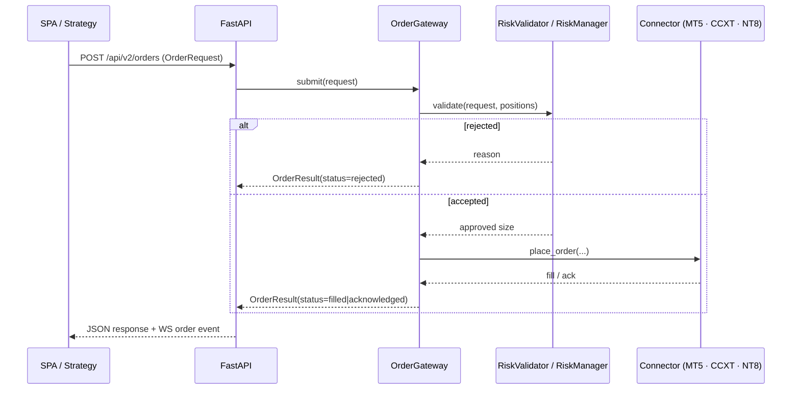

# Architecture

This document describes how Quantum Llama Terminal is put together: the processes,
the layers, the data that crosses them, and the parts of the design that are still
paying off technical debt. It is written to be read before changing the code.

Related documents: [`DEVELOPMENT.md`](DEVELOPMENT.md) for setup,
[`ML-PIPELINE.md`](ML-PIPELINE.md) for the model path, [`TESTING.md`](TESTING.md) for
what is covered, [`ROADMAP.md`](ROADMAP.md) for what comes next.

---

## 1. Process model

The product ships in four runnable shapes that share one codebase.

```mermaid
flowchart LR
  subgraph desktop [Desktop (Windows / Linux)]
    electron["electron/main.js<br/>supervisor"] --> backend["backend / start_api.py<br/>uvicorn :8050"]
    electron --> window["BrowserWindow"]
    window --> backend
  end

  subgraph standalone [Browser mode]
    launcher["browser_launcher.py"] --> backend2["uvicorn :8050+"]
    browser["Default browser"] --> backend2
  end

  subgraph cloud [Container (VPS)]
    proxy["Traefik / Coolify"] --> backend3["uvicorn :8050"]
  end

  subgraph local [Trading host]
    bridge["mt5_server.py<br/>MT5 bridge :8081"]
  end

  backend --> bridge
  backend2 --> bridge
  backend3 --> bridge
```

| Process | Entry point | Port | Responsibility |
| --- | --- | --- | --- |
| Electron supervisor | `electron/index.js` → `main.js` (or `main.jsc`) | — | Find a free port, start the backend, wait for readiness, enforce the license gate, own the window, kill the backend tree on exit |
| Application server | `start_api.py` → `src.platform.api.main:app` | `8050` (probes `8050-8059`) | REST, WebSocket, static SPA, market data, algorithms |
| MetaTrader 5 bridge | `mt5_server.py` | `8081` | Windows-only `MetaTrader5` package exposed over HTTP with a token |
| Trainer CLI dashboard | `run.py` (stdlib HTTP server) | `8000`+ | Serve the generated training dashboard |

The desktop shell does **not** load a `file://` UI. FastAPI serves the SPA, so the
desktop and browser modes are the same application; the shell only adds the window,
tray behavior and the license check.

### Why MetaTrader 5 is a separate process

`MetaTrader5` is a Windows-only CPython extension that must run next to a terminal
instance. Rather than fork the product per platform, the platform talks HTTP to a bridge
that can live on a Windows machine or under Wine
([`deploy/MT5_BRIDGE.md`](../deploy/MT5_BRIDGE.md)). The connector factory in
`src/live/connector.py` decides at import time between the HTTP connector and the native
package.

---

## 2. Layers

```text
┌──────────────────────────────────────────────────────────────────────────┐
│ Clients: Electron window · browser · Trainer CLI                         │
├──────────────────────────────────────────────────────────────────────────┤
│ API layer: src/platform/api/  (FastAPI routers, WebSocket, static files) │
├──────────────────────────────────────────────────────────────────────────┤
│ Services: market_data_engine · order_gateway · algo_engine · big_llama   │
│           security · database · auth · license · per-broker managers     │
├──────────────────────────────────────────────────────────────────────────┤
│ Engine: backtesting · genetic_optimizer · risk_manager · indicators      │
├──────────────────────────────────────────────────────────────────────────┤
│ Connectors: MT5 bridge client · CCXT · NinjaTrader replication · yfinance│
├──────────────────────────────────────────────────────────────────────────┤
│ Infrastructure: SQLite · JSON config · outputs/ · logs/ · Fernet keys    │
└──────────────────────────────────────────────────────────────────────────┘
```

The dependency rule: **a lower layer never imports a higher one**. The API layer may
import services; services may import the engine and connectors; the engine is pure
Python over pandas/numpy.

### Service responsibilities

| Module | Path | Responsibility |
| --- | --- | --- |
| Market data engine | `src/services/market_data_engine/` | Process-wide singleton that owns subscriptions, circular buffers, a thread pool and event fan-out |
| Order gateway | `src/services/order_gateway/` | Order queue (1000 slots), 4 workers, connector registry, fill mirroring |
| Risk validator | `src/services/order_gateway/risk_validator.py` | Per-order validation, daily order and PnL limits, position tracking |
| Algo engine | `src/services/algo_engine/` | Loads a trained model per symbol/timeframe, generates signals, emits orders |
| Big Llama | `src/services/big_llama/` | Evolutionary population loop and the abstract `EvolutionaryEngine` |
| Security | `src/services/security.py` | Fernet credential store, key directory resolution |
| Database | `src/services/database.py` | SQLite access for settings, workspaces, AI chat, AlgoLab state |
| Auth and license | `src/services/auth.py`, `license_service.py` | Supabase session check, machine-bound license validation |
| Broker managers | `src/services/{mt5,crypto,ninjatrader,tradovate}_manager.py` | Account catalogues, connection state, per-venue launch logic |
| Replication | `src/services/replication_service.py` | File-based command channel into NinjaTrader instances |
| Crypto proxy | `src/services/crypto_proxy.py` | Applies `CRYPTO_HTTP_PROXY` to CCXT exchanges |

---

## 3. HTTP and WebSocket surface

Routers are registered in `src/platform/api/main.py`.

| Prefix | Module | Domain |
| --- | --- | --- |
| `/api/v2` | `services_api.py` | Feed, orders, algo control, risk, config, `Llama` model calls; WebSockets `/ws/feed`, `/ws/orders`, `/ws/algo` |
| `/api/accounts` | `accounts_api.py` | Account CRUD, connection tests, broker discovery, leverage, server search |
| `/api/footprint` | `footprint_api.py` | Footprint bars computed from MT5 ticks or CCXT trades |
| `/api/backtest` | `backtesting_api.py` | Strategy catalogue, data load/upload/validate, run, optimize, results, PDF export, logs |
| `/api/analysis` | `analysis_api.py` | Technical analysis endpoint |
| `/ws`, `/ws/terminal` | `main.py` | Terminal-level streaming routes |
| `/health` | `main.py` | Liveness probe used by the container health check |
| `/api/license/check` | `main.py` | License gate queried by the Electron supervisor |
| `/api/system/telemetry` | `main.py` | CPU/GPU/memory telemetry for the UI |
| `/api/algo/*` | `main.py` | Start, stop, live, status, clean and logs for the algorithm runtime |

Serving order matters: the SPA catch-all is registered **after** every API route, so a
new router added later must be registered before it, or its paths will be swallowed by
the `index.html` fallback.

---

## 4. Order lifecycle

Every order — manual, algorithmic or replayed — follows the same funnel.



Two risk implementations exist and both are wired: `order_gateway/risk_validator.py`
(JSON live configuration) guards the platform path, and `engine/core/risk_manager.py`
(YAML configuration) guards the engine/backtest path. Unifying them is tracked in the
roadmap; until then, a change to one does not change the other.

---

## 5. Market data flow

```text
venue (MT5 bridge | CCXT | yfinance)
  → connector (src/live/*.py)
  → MarketDataEngine (subscriptions, buffers, thread pool)
  → consumers:
      · indicator primitives (src/engine/indicators, src/indicators)
      · footprint aggregation (src/platform/api/footprint_api.py)
      · WebSocket streams (SPA charts)
      · AlgoEngine (signal generation)
  → SQLite / outputs/ (persisted artefacts)
```

Buffers are circular and per-subscription; consumers that fall behind drop the oldest
samples rather than growing memory without bound. The SPA receives incremental updates and
re-renders overlays in place.

---

## 6. Persistence and secrets

| Store | Location (development) | Contents |
| --- | --- | --- |
| Application SQLite | `config/quantum_llama.db` | Settings, workspaces, last active workspace, AI chat, AlgoLab state |
| Engine SQLite | `data/trading.db` | Engine-local trading records |
| Configuration | `src/config/*.json` | Symbol catalogues per venue, accounts, live configuration |
| Engine configuration | `engine/config/config.yaml` | Risk thresholds and engine parameters |
| Model artefacts | `outputs/models/` | `<ticker>_<timeframe>_generator.pth`, `_scaler.pkl`, `_config.json` |
| Runtime status | `outputs/live_status.json` | Status consumed by the dashboard |
| Logs | `logs/` | Runtime logs (never committed) |
| Secrets | `.env`, `*.key`, `QUANTUM_LLAMA_KEY_DIR` | Supabase keys, bridge token, Fernet keys |

Credentials are encrypted with Fernet. The key file is created on demand next to the
data directory, or under `QUANTUM_LLAMA_KEY_DIR` when the application runs in a container
with a read-only tree. Nothing in this list is committed; see `.gitignore`.

---

## 7. Configuration resolution

```text
.env  →  os.environ  →  src/config/*.json  →  defaults in code
```

Environment variables that change behavior:

| Variable | Effect |
| --- | --- |
| `MT5_BRIDGE_URL` | Bridge endpoint (default `http://127.0.0.1:8081`) |
| `MT5_BRIDGE_TOKEN` | Shared secret required on every bridge call |
| `MT5_BRIDGE_BIND` / `MT5_BRIDGE_PORT` | Bind interface and port of the bridge |
| `MT5_AUTO_LAUNCH` | Let the client start the local bridge on demand |
| `USE_MT5_API` | `true` / `false` / `auto` connector selection |
| `CRYPTO_HTTP_PROXY` | Route crypto exchange traffic through a proxy |
| `QUANTUM_LLAMA_KEY_DIR` | Writable directory for key material |
| `APP_PORT` | Container listen port (default `8050`) |

---

## 8. Build and packaging topology

Three toolchains coexist:

| Stage | Tool | Output |
| --- | --- | --- |
| Python backend | PyInstaller (`scripts/build_backend.py`) | `build/pyinstaller_dist/backend`, `Trainer`, `BrowserMode` |
| Obfuscation | PyArmor (`scripts/obfuscate.py`) | `build/obf_src` for security- and licensing-critical modules |
| Electron JS | bytenode (`scripts/build_js.js`) | `electron/main.jsc`, `preload.jsc` |
| Installers | electron-builder | NSIS (Windows), AppImage + deb (Linux) |
| Research build | Nuitka (`build_dist.py`) | Standalone `start_api` binary (not wired into `npm run dist`) |

`npm run dist` runs the PyInstaller path, then bytenode, then electron-builder.

---

## 9. Known architectural debt

Recorded deliberately: this is what a maintainer should know before touching the code.

| # | Observation | Consequence |
| --- | --- | --- |
| 1 | The readiness probe used by the Electron supervisor and `browser_launcher.py` is `/api/health`, but only `/health` exists. | The SPA catch-all answers `200` with `index.html`, so the probe passes even when the backend is not ready. |
| 2 | Two live-trading paths: the legacy CLI loop (`src/live/live_trade.py`) and the platform path (MarketDataEngine → OrderGateway → AlgoEngine). | Fixes applied to one do not reach the other. |
| 3 | Two backtesting engines (`src/analysis/backtester.py`, `src/engine/backtesting/backtester.py`) and two risk implementations. | Results and limits can disagree between the trainer and the platform. |
| 4 | `src/platform/api/main.py` is ~4,600 lines and mixes routing, startup, licensing, telemetry and static serving. | Hard to review, easy to create import cycles. |
| 5 | Duplicate imports and dead modules exist (`src/models/gan.py`, `src/platform/web/App.jsx`). | Misleads readers about what ships. |
| 6 | The API reports version `2.4.0` while the package is `1.8.1`. | Any client depending on the version endpoint sees the wrong value. |
| 7 | `transformers` and `xgboost` are pinned in `requirements.txt` but unused. | Larger installs, slower CI images, false expectations. |
| 8 | `src/doctecnicaalgos/EvolutionaryGAN.md` describes a GAN that the shipped trainer does not implement. | Documentation overstates the ML path. |

Each item maps to an issue tracked under the `roadmap` and `tech-debt` labels.

---

## 10. Extension points

- **New venue**: implement the connector interface, register it in
  `order_gateway/gateway.py`, add an account manager, then a route group.
- **New indicator**: add the primitive under `src/engine/indicators/`, export it from
  the package `__init__`, then surface it in the indicator registry.
- **New strategy**: implement `strategy_base.py`, register it in
  `src/algorithms/__init__.py` (lazy import), and add a backtest fixture.
- **New model**: extend `src/features`, train through `train.py`, and honour the
  artefact naming contract `<ticker>_<timeframe>_generator.{pth}` +
  `_scaler.pkl` + `_config.json` that the algo engine reads.
