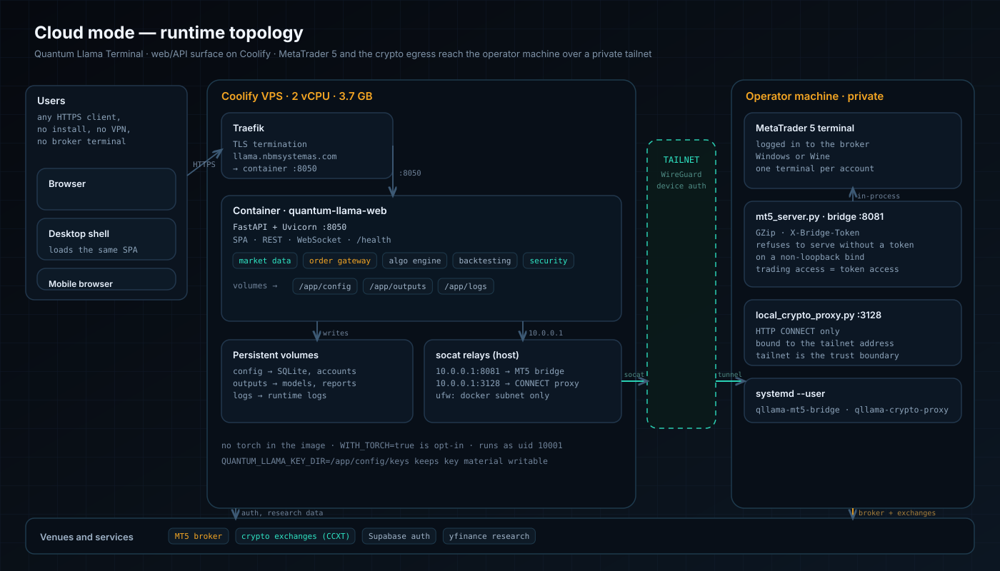
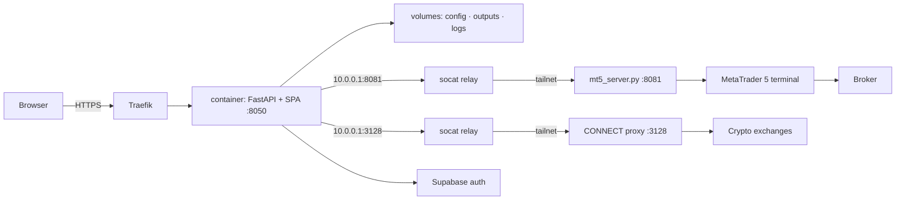
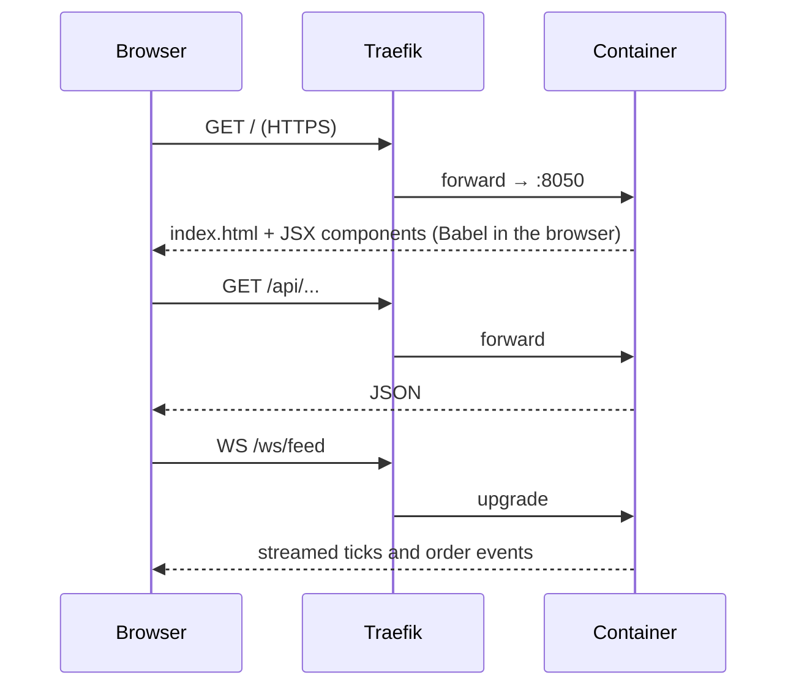

# Cloud mode

Quantum Llama Terminal runs in two shapes from one codebase: the **desktop
application** and the **cloud deployment** (web/API only). This document describes the cloud
shape end to end — what runs where, how a request reaches a broker, what is persisted, how it
is secured, how to operate it, and which integration problems had to be solved to make a
Windows-only trading terminal usable from a Linux container.

Runbooks with the exact commands live in [`../deploy/COOLIFY.md`](../deploy/COOLIFY.md) and
[`../deploy/MT5_BRIDGE.md`](../deploy/MT5_BRIDGE.md). The decision behind the bridge is
recorded in [`adr/0001-mt5-behind-an-http-bridge.md`](adr/0001-mt5-behind-an-http-bridge.md).

---

## 1. What cloud mode is

| | Desktop application | Cloud mode |
| --- | --- | --- |
| Interface | Electron window over the local SPA | The same SPA in a browser |
| Backend | Local `uvicorn` on `127.0.0.1:8050` | `uvicorn` in a container on the VPS |
| Market data | Local MT5 package or bridge, CCXT | Bridge over a private network, CCXT through a proxy |
| Training and GPU | Local, full stack incl. `torch` | Excluded from the image; opt-in build arg |
| State | Project directory | Three Docker volumes |
| Access | The machine itself | HTTPS on a public hostname |

Same application, same routes, same SPA. The container is the desktop backend without the
Electron shell, the MT5 terminal and the training stack.

Live deployment: `https://llama.nbmsystemas.com`. `GET /health` reports the runtime state, not
just liveness — on the current deployment it answers:

```json
{"ready_for_ui": true, "mt5_status": "connected",
 "services": {"market_data": "ONLINE", "order_gateway": "running", "algo_engine": "STOPPED"}}
```

The `mt5_status` field is the end-to-end proof of section 8: the container is asking the bridge
on the operator machine for the terminal state, and the bridge answers.

---

## 2. Topology



Four zones:

1. **Users** — any browser. No installation, no VPN, no broker terminal.
2. **Coolify VPS** — Traefik terminates TLS and forwards to the container; the container runs
   FastAPI, the SPA, the WebSocket streams and the services; persistent volumes hold state.
3. **Private tailnet** — WireGuard between the VPS and the operator machine. Not a public
   endpoint, not a port-forward.
4. **Operator machine** — where MetaTrader 5 and the crypto egress actually live: the MT5
   terminal, the token-authenticated bridge on `:8081`, and a CONNECT proxy on `:3128`.



---

## 3. Request paths

### A browser loads the terminal



The SPA is served by FastAPI, so there is no separate static host and no CORS policy. The
catch-all for unknown paths returns `index.html`, which is why the container health check
targets `/health` and not `/`.

### An order reaches a broker

```text
SPA / algorithm
  → POST /api/v2/orders
  → OrderGateway (queue + 4 workers)
  → RiskValidator (daily limits, position tracking)
  → connector: MT5 bridge | CCXT | NinjaTrader
  → container -> 10.0.0.1:8081 (socat) -> tailnet -> mt5_server.py -> MetaTrader 5 -> broker
```

Every hop after the gateway is venue-specific; the gateway itself never talks to a broker
directly. See [`ARCHITECTURE.md`](ARCHITECTURE.md) section 4.

### Crypto data leaves through the operator machine

```text
container (CRYPTO_HTTP_PROXY=http://10.0.0.1:3128)
  -> socat relay on the VPS
  -> CONNECT proxy on the operator machine (tailnet)
  -> exchange
```

Only CCXT traffic is affected. MT5, Supabase and yfinance keep their normal path.

---

## 4. Environments and configuration

| Variable | Container | Operator machine | Why it differs |
| --- | --- | --- | --- |
| `APP_PORT` | `8050` | — | Port Traefik forwards to |
| `MT5_AUTO_LAUNCH` | `false` | `true` | There is no MT5 to boot inside the container |
| `MT5_BRIDGE_URL` | `http://10.0.0.1:8081` | — | The relay, not the tailnet address (see problem 2) |
| `MT5_BRIDGE_TOKEN` | same value | same value | Required on every bridge call |
| `MT5_BRIDGE_BIND` | — | `0.0.0.0` | Must accept tailnet traffic |
| `CRYPTO_HTTP_PROXY` | `http://10.0.0.1:3128` | — | Regional block on the exchange (problem 4) |
| `QUANTUM_LLAMA_KEY_DIR` | `/app/config/keys` | unset | Container user cannot write the project root |
| `TZ` | `America/Argentina/Buenos_Aires` | same | Sessions and chart time |
| `SUPABASE_URL` / `SUPABASE_ANON_KEY` | required | — | No compiled defaults; without them authentication is disabled |

---

## 5. Persistence and backup

| Volume | Mount | Contents | Back up? |
| --- | --- | --- | --- |
| `qllama-config` | `/app/config` | SQLite (settings, workspaces), accounts, live and symbol configuration, keys | **Yes**, before any configuration change |
| `qllama-outputs` | `/app/outputs` | Trained models, scalers, generated reports | Yes, it is the training output |
| `qllama-logs` | `/app/logs` | Runtime logs | No |

Docker copies the image's default contents into an empty volume on first start, so the shipped
configuration survives. A redeploy replaces the image, never the volumes.

One consequence worth knowing: configuration edited from the UI is written to the volume and
therefore is **not** in Git. `src/config/*.json` in the repository is the seed, not the runtime
state.

---

## 6. Security model

| Control | Implementation |
| --- | --- |
| Transport | TLS terminated at Traefik; internal hops stay inside the Docker network |
| Bridge authentication | `X-Bridge-Token` middleware on every request; the bridge refuses a non-loopback bind without a token |
| Network exposure | The bridge is reachable only through the tailnet; no public port-forward, no inbound firewall hole |
| Relay scope | The socat relay listens on the Docker bridge gateway and is firewalled to the Docker subnet (`ufw allow from 10.0.0.0/24`) |
| Egress proxy | Binds to the tailnet address; the tailnet is the trust boundary and the proxy has no user authentication |
| Credentials at rest | Fernet; key material lives in `QUANTUM_LLAMA_KEY_DIR`, outside Git and outside the image |
| Repository access | Coolify clones with a read-only deploy key |
| Container | Non-root (`uid 10001`), health check, no secrets baked into the image |

What is **not** in place yet, stated plainly: the bridge has a single shared token and no
per-user accounts, so anyone holding the URL and the token has the trading authority of the
logged-in terminal. Rotate the token by changing it on both sides and redeploying.

---

## 7. Operating the deployment

```bash
# health and identity
curl -s https://llama.nbmsystemas.com/health
curl -s https://llama.nbmsystemas.com/api/platform/version

# static assets and SPA
curl -s -o /dev/null -w '%{http_code} %{content_type}\n' https://llama.nbmsystemas.com/

# bridge reachability from the container's network
curl -s -H "X-Bridge-Token: $MT5_BRIDGE_TOKEN" http://10.0.0.1:8081/api/balance
```

| Action | How |
| --- | --- |
| Deploy a new version | Push to the tracked branch, then deploy the application in Coolify (UI or `POST /api/v1/deploy`) |
| Roll back | Redeploy the previous image from Coolify; volumes are untouched |
| Follow logs | Container logs in Coolify, or `journalctl --user -u qllama-mt5-bridge -f` on the operator machine |
| Restart a local service | `systemctl --user restart qllama-mt5-bridge qllama-crypto-proxy` |
| Rotate the bridge token | Change `MT5_BRIDGE_TOKEN` on both sides, restart the bridge, redeploy the app |

Capacity: 2 vCPU / 3.7 GB. The image ships CPU-only `torch` (`WITH_TORCH=true` by default,
roughly 2 GB) because training runs in the container. Training on those two vCPUs is slow;
build with `--build-arg WITH_TORCH=false` for a data/execution-only image.

---

## 8. Integration problems, cause and fix

Recorded because this is where the engineering actually happened. Each row is a real failure
observed during the cloud rollout, the reason it happened, and the change that fixed it.

| # | Problem observed | Cause | Fix | Commit |
| --- | --- | --- | --- | --- |
| 1 | `import MetaTrader5` fails on Linux; the container cannot trade | `MetaTrader5` is a Windows-only CPython extension attached to a local terminal | Serve the venue over HTTP from a process next to the terminal and select the connector at runtime | `13ff331`, ADR 0001 |
| 2 | The container cannot reach the bridge on `100.x.y.z`; requests time out | Tailscale drops traffic to tailnet addresses arriving from a non-tailnet interface (the Docker bridge) | Relay on the VPS host from the Docker gateway to the tailnet peer, firewalled to the Docker subnet | `2b36db5` |
| 3 | The symbol catalogue took seconds and returned thousands of symbols; charts stalled | The full catalogue was re-downloaded and transferred on every call | Serve the catalogue through the bridge, cache it, gzip the response and filter server-side; also list symbols whose `trade_mode` is unknown | `e8346f5`, `8bcb8d2`, `b144025`, `06f8f86` |
| 4 | Binance answers `HTTP 451 (restricted location)` from the VPS region | The provider blocks the datacentre's region, not the operator's | Route crypto egress through a CONNECT proxy on the operator machine over the tailnet | `190f86e`, `931172a` |
| 5 | Bridge calls from the cloud were rejected or leaked error payloads as data | The token was not sent on every call; error payloads were treated as success | Send `X-Bridge-Token` on every request and reject error payloads; a shared session is no longer torn down by a single request | `75211dd`, `e726015` |
| 6 | The container started but authentication and key storage failed | The runtime user cannot write the project root, so Fernet keys could not be created | `QUANTUM_LLAMA_KEY_DIR` for key material and a writable application tree | `5b8c95a`, `f17d6fd` |
| 7 | The SPA loaded but vendored libraries, images and the favicon were missing | The image did not ship the vendored web assets; unknown paths fell back to `index.html` | Copy the vendored libraries and images into the image, serve a real favicon | `82d97d7`, `54e635f` |
| 8 | The bridge would not start under Wine | Wine needs the Windows Python inside the same prefix | Launch the bridge with the Windows Python inside the prefix, as a user service | `736a72b`, `626ba7c` |

Together they describe the shape of the solution: **keep the broker-facing code where the
broker is, expose it over one authenticated contract, and treat the network between the two as
hostile.** Nothing in the container needs to know that MT5 is Windows-only.

---

## 9. Limits of cloud mode

- **No Electron shell.** The browser tab is the interface; desktop-only affordances (native
  menus, tray, local file dialogs) are not available.
- **Training runs on the container's CPU.** `torch` is included (`WITH_TORCH=true`), so
  training works but is slow on 2 vCPU. A workstation with a GPU is still the better place for
  long runs; the data, charting, backtesting and execution paths do not depend on it.
- **One SQLite writer.** The deployment is single-node by design; scaling out would need a
  server database.
- **Single shared bridge token** with no per-user authorization (see section 6).
- **The API reports platform version `2.4.0`** while the product is on a different line —
  tracked as issue #8, not fixed here because old clients compare that value.

---

## 10. Related documents

| Document | Contents |
| --- | --- |
| [`../deploy/COOLIFY.md`](../deploy/COOLIFY.md) | Coolify resources, volumes, deploy and verify commands |
| [`../deploy/MT5_BRIDGE.md`](../deploy/MT5_BRIDGE.md) | Bridge setup on Windows and Wine, tailnet, relays, troubleshooting |
| [`ARCHITECTURE.md`](ARCHITECTURE.md) | Process model, layers, order lifecycle, known debt |
| [`DEVELOPMENT.md`](DEVELOPMENT.md) | Local setup, running modes, packaging |
| [`adr/0001-mt5-behind-an-http-bridge.md`](adr/0001-mt5-behind-an-http-bridge.md) | Why the bridge exists |
| [`RELEASES/v1.9.0.md`](RELEASES/v1.9.0.md) | Release that introduced cloud mode |
