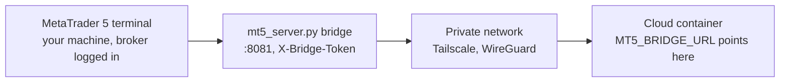

# Onboarding: connecting the platform to your machine

Quantum Llama Terminal does not talk to a broker by itself. The `MetaTrader5`
Python package is Windows-only, so **your terminal stays on your machine** and
the platform reaches it over HTTP through a small bridge. This page is the
support-friendly version of the same procedure the app shows from the login
screen ("Configurar mi sistema").

The exact commands for the operator live in
[`deploy/MT5_BRIDGE.md`](../deploy/MT5_BRIDGE.md) and the runtime shape of the
deployment lives in [`docs/CLOUD.md`](CLOUD.md). This page links to them instead
of copying every command, so it cannot drift.

---

## 1. Why a bridge exists

| Constraint | Consequence |
| --- | --- |
| The `MetaTrader5` package runs on Windows only | The terminal cannot run inside the Linux container |
| Broker data and orders live in that terminal process | Something on your machine must expose it |
| The cloud app still needs that data | A small HTTP bridge, `mt5_server.py`, does the exposing |

So the terminal keeps running where your broker connection already works, and
the platform reads and trades through the bridge. Nothing about your broker
account moves to the cloud.

---

## 2. Topology



Four hops, in this order: terminal, bridge on port `8081`, private network, and
finally the cloud container. Nothing else is published.

---

## 3. Environment variables

| Variable | Default | What it controls |
| --- | --- | --- |
| `MT5_BRIDGE_BIND` | `127.0.0.1` | Interface the bridge listens on. Set `0.0.0.0` to expose it on the private network. |
| `MT5_BRIDGE_PORT` | `8081` | Port the bridge listens on. The platform URL must use the same port. |
| `MT5_BRIDGE_TOKEN` | (unset) | Shared token checked on every request. Required as soon as another machine can reach the bridge. |
| `MT5_BRIDGE_URL` | `http://127.0.0.1:8081` | Where the platform looks for the bridge when the variable is unset. |

`127.0.0.1` with no token is the desktop-only default and stays valid for a
single machine. The moment another machine can reach the bridge, a token is
**mandatory**: the bridge can place orders, and anyone holding the URL and the
token has the same trading access on the signed-in terminal.

---

## 4. The seven steps

### Step 1 — Install MetaTrader 5 and log in to your broker

Install the terminal on the machine that will host the bridge: Windows, or Linux
running MetaTrader 5 under Wine. Log in to your broker account inside the
terminal, because market data and orders need an authenticated session, and
leave the terminal open while the platform is in use.

### Step 2 — Get the project running on the same machine

Clone the repository and run the setup script from the project root. It creates
the virtual environment and installs `requirements.txt`:

```bash
./setup_env.sh      # Linux and macOS, creates venv_linux
```

```bat
setup_env.bat       # Windows, creates venv
```

### Step 3 — Generate the bridge token

```bash
python -c "import secrets; print(secrets.token_urlsafe(32))"
```

Copy the printed value. Keep it out of git, screenshots and support tickets, and
rotate it by changing it on both sides and restarting both processes.

### Step 4 — Start the bridge with that token

Windows, in the environment where MetaTrader 5 runs:

```bat
set MT5_BRIDGE_BIND=0.0.0.0
set MT5_BRIDGE_TOKEN=<your token>
start_mt5_server.bat
```

Linux with Wine, inside the same prefix:

```bash
export MT5_BRIDGE_BIND=0.0.0.0
export MT5_BRIDGE_TOKEN=<your token>
wine python -m uvicorn mt5_server:app --host "$MT5_BRIDGE_BIND" --port 8081
```

`MT5_BRIDGE_PORT` defaults to `8081`. The pair `127.0.0.1` with no token is the
desktop-only default; do not keep it once another machine needs to connect.

### Step 5 — Connect the two sides

The process running the platform needs both values, and they must match the
bridge exactly:

- `MT5_BRIDGE_URL`: the address that reaches the bridge from the machine running
  the platform.
- `MT5_BRIDGE_TOKEN`: the same token the bridge was started with.

When `MT5_BRIDGE_URL` is unset the platform falls back to
`http://127.0.0.1:8081`, which only works when the bridge and the platform share
a host. Keep the bridge on a private network such as Tailscale, never on a
public address.

### Step 6 — Verify end to end

Ask the bridge for real data from the machine that runs it:

```bash
curl -s -H "X-Bridge-Token: <your token>" http://127.0.0.1:8081/api/balance
```

Then check the platform. Its `/api/health` response must report `mt5_status`
`connected` and `services.market_data` `ONLINE`:

```json
{"ready_for_ui": true, "mt5_status": "connected",
 "services": {"market_data": "ONLINE"}}
```

Inside the terminal itself, the status bar along the bottom of the screen names
the platform and shows `CONNECTED` once the bridge answers. Until both fields
are green, nothing else in the platform will behave.

### Step 7 — Add crypto accounts (optional)

CCXT exchange keys are entered inside the app: open Settings from the gear
button in the top bar and use the **Accounts** tab to add a `CRYPTO` account
with its API key, secret and the passphrase if the venue asks for one.

Some venues block the server region. When that happens the deployment also needs
an egress proxy; that is an operator concern described in
[`deploy/MT5_BRIDGE.md`](../deploy/MT5_BRIDGE.md) and
[`docs/CLOUD.md`](CLOUD.md).

---

## 5. What success looks like

| Signal | Where | Value |
| --- | --- | --- |
| Bridge answers with data | `http://127.0.0.1:8081/api/balance` with the token header | a balance payload, not `401` |
| Terminal reachable from the platform | `/api/health` | `mt5_status` is `connected` |
| Market data flowing | `/api/health` | `services.market_data` is `ONLINE` |
| Terminal view | status bar at the bottom of the app | platform shown as `CONNECTED` |

---

## 6. Troubleshooting

| Symptom | Cause and fix |
| --- | --- |
| `401 invalid bridge token` | The token differs between bridge and platform. Set the same `MT5_BRIDGE_TOKEN` on both sides and restart both. |
| Nothing answers on the port | The bridge is not running, or a firewall drops `8081`. Bind `0.0.0.0` and allow `8081` only on the private interface. |
| Reachable locally, not from the cloud | The private network is down. Check that both machines are signed in and can see each other on Tailscale. |
| `Could not connect to MT5` | The terminal is closed or not logged in to the broker account. Open it, sign in, and retry. |
| Wrong port | `MT5_BRIDGE_PORT` and the port inside `MT5_BRIDGE_URL` must agree. The default is `8081`. |

---

## 7. Operator references

- [`deploy/MT5_BRIDGE.md`](../deploy/MT5_BRIDGE.md) — exact bridge and
  private-network commands, including the relay used by the cloud container.
- [`docs/CLOUD.md`](CLOUD.md) — what runs where in cloud mode, request paths and
  persistence.
- [`deploy/COOLIFY.md`](../deploy/COOLIFY.md) — deployment runbook.
